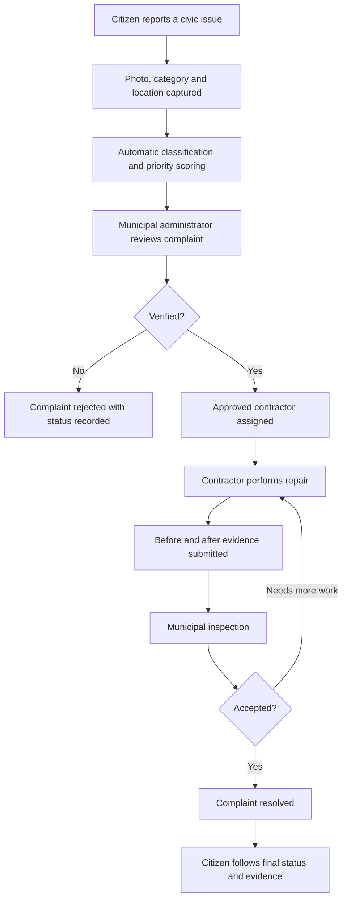

# 🏙️ CivicConnect AI

### **Report it. Track it. Fix it.**

**A smarter, more transparent way to connect citizens, municipalities, and repair contractors.**

**Smart Communities • Civic Technology • Flutter + Supabase**

[The Problem](#-the-problem) • [Our Solution](#-our-solution) • [How It Works](#-how-it-works) • [Features](#-key-features) • [Technology](#-technology-stack) • [Demo](#-demo-video)

---

## 🚨 The Problem

A broken streetlight, overflowing garbage, or a dangerous pothole may look like a small issue—until it affects an entire neighborhood.

Yet reporting civic problems can be frustrating:

- **No clear reporting channel:** Citizens may not know where or how to report a local issue.
- **Limited visibility:** After reporting, people often cannot easily follow what happens next.
- **Slow coordination:** Municipal teams need to review issues and coordinate with the people responsible for repairs.
- **Weak accountability:** Without a clear trail of updates and proof of work, it can be difficult to see whether an issue was actually resolved.
- **Repeated reports:** Multiple residents may report the same problem, making prioritization harder.

**The core challenge:** How can a city turn a citizen's complaint into a visible, accountable repair process?

## 💡 Our Solution

**CivicConnect AI** is a mobile-first civic complaint management platform that brings **citizens, municipal administrators, and verified contractors** into a connected workflow.

A citizen reports an issue with a photo and location. A municipal administrator reviews and assigns the complaint. An approved contractor performs the repair and provides evidence. The municipality verifies the outcome, while the citizen can follow the complaint through its status timeline.

Rather than treating a complaint as a one-time message, CivicConnect AI treats it as a **trackable service request—from submission to resolution**.

> **One platform. Three roles. A more accountable path to better neighborhoods.**

## 🔄 How It Works

### 👤 Citizen

**Spot a problem → Report it → Follow its progress.**

Citizens can sign up, submit location-based complaints, attach photos, and track complaint stages. The platform supports everyday issues such as **potholes, faulty streetlights, and garbage**. Community interactions and feedback help make reported problems visible.

### 🏛️ Municipal Administrator

**Review reports → Prioritize → Assign → Verify.**

Authorized municipal staff review incoming complaints, verify their validity, examine potential duplicates, assign work to approved contractors, and inspect submitted repairs before marking complaints resolved.

### 🦺 Contractor

**Apply → Get approved → Repair → Submit proof.**

Contractors register their business, select a municipality, and wait for municipal approval. Once approved, they can access their assigned work, update progress, and submit repair evidence.

## ✨ Key Features

| Capability | What it delivers |
|---|---|
| 🔐 **Role-based access** | Separate, secured experiences for citizens, municipal admins, and approved contractors |
| 📍 **Location-aware reports** | GPS coordinates and map-based context for complaints |
| 📷 **Photo evidence** | Visual documentation of reported issues and repair progress |
| 🧠 **Smart categorization** | Rule-based keyword classification of common civic problems |
| 🚦 **Priority scoring** | Server-side scoring using issue category and safety-related terms |
| 🔎 **Duplicate suggestions** | Flags potentially related complaints using distance, category, and text similarity |
| ✅ **Municipal verification** | Complaint review, contractor assignment, and repair inspection |
| 🛠️ **Repair accountability** | Contractor progress and before/after repair evidence |
| 🕒 **Status timeline** | A traceable history of complaint status updates |
| 📱 **Mobile-first design** | Flutter UI with light/dark theme support and responsive layouts |

### What makes CivicConnect AI different?

**It's not just a complaint form.** It connects the people reporting a problem with the people responsible for solving it—and provides a process to follow the work all the way to resolution.

The platform also uses **rule-based intelligence** for initial categorization, priority, and duplicate suggestions. It does **not** claim to use a trained machine-learning classifier; its approach is intentionally lightweight and practical for a hackathon MVP.

## 🧰 Technology Stack

| Layer | Technology |
|---|---|
| Cross-platform application | **Flutter / Dart** |
| State management | **BLoC / Cubit** |
| Application structure | **Feature-first MVVM** |
| Navigation | **GoRouter** |
| Authentication | **Supabase Auth** |
| Database and authorization | **Supabase PostgreSQL + Row Level Security** |
| Media storage | **Supabase Storage** (private buckets) |
| Location and mapping | **Device GPS + OpenStreetMap-based map** |
| Preferences and local state | **SharedPreferences** where appropriate |
| Smart complaint processing | **PostgreSQL functions and triggers** |

## 🔒 Security and Trust

CivicConnect AI separates public registration from privileged access:

- New citizen accounts do not choose their own privileged database role.
- Municipal administrator accounts are provisioned through trusted administration.
- Contractor applications require municipal approval before contractor access is granted.
- Supabase Row Level Security and server-side checks protect key workflows.
- Complaint and repair images are stored in private storage buckets.

## 🎬 Demo Video

**The full app experience is presented in our demo video rather than screenshots in this README.**

**▶️ Demo video:** _Add your video URL here before submission._

### Suggested walkthrough

1. Citizen signs in and submits a pothole complaint with location and photo.
2. Municipal admin reviews the complaint and assigns an approved contractor.
3. Contractor opens the job, records progress, and submits repair evidence.
4. Admin inspects and accepts the completed repair.
5. Citizen checks the resolved status and timeline.

## 🎯 MVP Scope and Roadmap

Our hackathon focus is the **complete civic complaint lifecycle**: report, verify, assign, repair, inspect, and resolve.

Potential future extensions include advanced AI-based image recognition, richer municipal analytics, automated public notifications, competitive tendering, and production-scale deployment.

We believe that a useful smart-city tool begins with something simple: **help residents be heard, and make progress visible.**

---

### **CivicConnect AI**

**Building smarter communities through transparency, coordination, and action.**

*Made for a Smart Communities Hackathon* 🏙️

